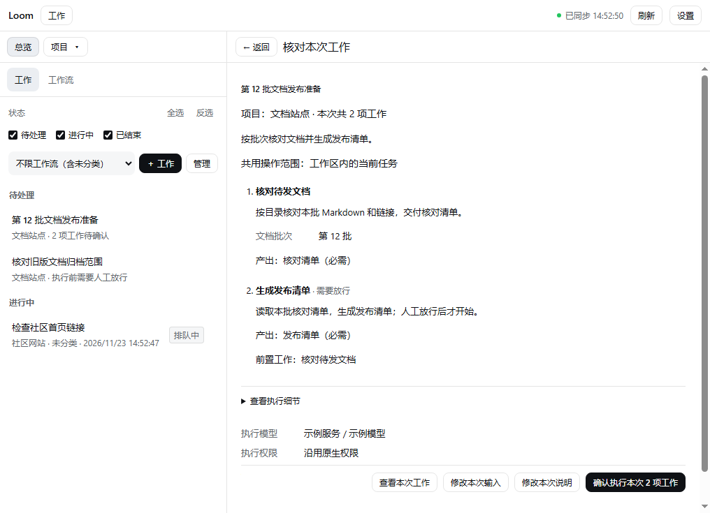
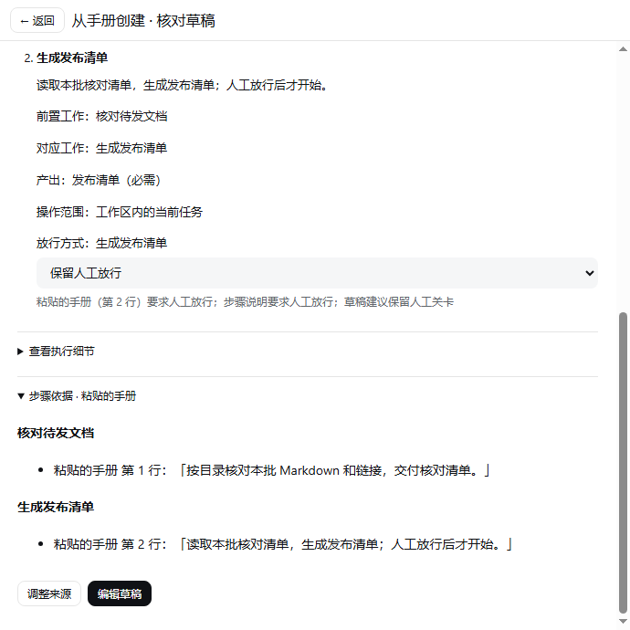

# dsh-loom

DeepSeek Harness 的跨工作区工作协调插件。在 **Loom 工作台** 中安排工作、查看执行进度和验收结果，通过原生会话继续讨论、查看工具调用并处理审批。

## 界面示例

**工作台 · 核对本次工作**。从左侧「待处理」打开提案，查看本批输入、产出和放行条件，再确认执行。



**从手册创建 · 核对草稿**。按你的工作清单检查生成的步骤、交接、手册依据和放行方式，再编辑并保存为模板。



以上截图使用虚构项目和批次。

## 安装与启用

需要 **DSH 0.2.3-alpha.2**。构建和测试建议使用 DSH 随附的 Node.js；单独安装时，使用 Node.js 24.22.3 或更新的 24.x，或 26.13.1 及以上。在插件源码目录执行：

```sh
npm install
npm run build
```

使用 DSH CLI 安装到目标 profile；将示例中的路径替换为插件源码目录的绝对路径，`web` 替换为实际使用的 profile：

```sh
dsh plugin --profile web add "/absolute/path/to/dsh-loom"
```

等待当前会话和后台任务结束后重启该 profile 的 Host。在侧栏打开 **Loom 工作台**，选择 **开始对话**。

本地目录安装的升级方式是更新源码、重新执行安装依赖与构建命令，再重启 Host。

## 日常使用

1. 在协调对话中说明目标和所属工作区，例如“在网站项目中增加导出功能，并检查生成的文件”。归属待确认的请求会保存为待澄清意图。
2. 总控发布的普通工作使用默认执行模型和项目权限，直接排队。需要指定其他模型或权限、配置命令检查，或明确要求先审阅时，在工作台核对后再执行。
3. 条件满足后自动执行。在工作详情中查看进度、打开执行会话，或补充要求、暂停和取消工作。
4. 结果进入待验收后，查看检查与预验收意见，选择验收或提交返工反馈。返工沿用工作及其主会话。

**项目**就是 DSH 工作区。**工作**针对一组输入完成一个目标。要在同一项目中反复做相同的一组工作，就把步骤、依赖和完成条件保存为**工作流**。

已有操作手册时，在 **工作流 → ＋ 工作流 → 从手册创建** 选择项目，在 **要做哪些工作** 按顺序填写，每行一项。可以多选本机 `.md` 或 `.markdown` 文件，也可以填写项目内的 Markdown 或 `SKILL.md` 相对路径、粘贴 Markdown。按需勾选同项目的已有工作作为参考。生成时，工作清单、手册文件名与正文、参考工作说明和补充说明会发送给已配置的协调模型。

核对清单中每项工作对应的步骤、手册依据、产出和交接，再逐步选择执行前是否需要放行。手册明确要求审批或有资源待核对的步骤保留人工放行。文件存在仅代表已完成静态核对；技能运行条件、外部服务和登录在放行时核对。补齐缺失的文件或更正路径后可重新生成。编辑并 **保存模板** 后，在工作流详情选择 **使用工作流**，填写首批输入，再确认执行。后续各批沿用同一模板，各自填写输入和确认。

例如，每批数据都要上传、等待训练、下载结果：第一次可以选 **执行一次**，也可以选 **保存为工作流并执行**。先核对本次项目、输入、模型和命令检查，再确认执行。下一批选 **使用工作流**，填入新数据并确认，就会创建一组新的工作。之后编辑工作流，不会改写前一批工作的输入或结果。

在确认页选择 **修改本次输入**，可以改批次参数和步骤预填的值，也可以为没有输入的步骤补充本次材料。上游步骤交付的结果会标明来源，执行时自动传入。选 **保存并核对** 回看每项工作的输入，选 **确认执行** 创建工作。要让改动适用于以后的批次，在工作流详情选择 **编辑模板**。

打开具体工作后：

- **输入**：查看本次材料和工作要求。执行参数按需展开，操作范围在确认执行时核对。
- **输出**：查看工作状态。有文件直接交给你时，从这里打开文件。
- **报告**：点击标题，在工作台内阅读执行助手撰写的中英文报告。需要你决定，或协调助手需要汇总结果时，另列一份补充报告。早期工作保留当时的文字摘要。

总控会话默认显示在主面板。设置、表单、执行核对和文件预览会使用同一区域；点面板顶部的 **返回** 继续原来的工作或对话。Markdown 显示排版后的报告，源码按语言高亮，图片和 PDF 可以缩放，Excel 可以切换工作表。Word 和 PowerPoint 由 DSH 转成 PDF 阅读，HTML 以静态页面打开。阅读完毕返回原工作标签。需要查看执行过程或处理审批时，点 **查看对话**；在会话页点 **返回上一页** 回到原处。

工作等待外部结果时，总控会在约定时间核对项目记录、相关工作结果和项目会话。找到线索后，总控把摘要和来源交给原工作会话，继续核对同一笔操作。如果仍在等待结果，总控可安排下次复查。确实缺少关键信息时，在 **待处理 → 查看待补信息** 补齐。上游返工产生新结果时，可以选择哪些下游工作重跑；未选中的工作保留原结果。本地取消结束对远端操作的跟踪。

**取消工作** 停止执行，原要求和记录可在「已结束」回看。**删除工作** 在再次确认后移除这项工作的 Loom 记录；项目文件和 DSH 对话保留。生成工作前，删除针对整份提案，确认页列出本次的所有步骤。生成工作后，删除针对所选工作。如果仍有记录引用它，确认页会列出名称；点工作或工作流可查看详情，再返回原工作。

同一工作区串行执行，不同工作区可并行。总控自动启动的批次中，有检查或必需输出的中间交接，在输出齐备、检查和预验收通过后继续下游。最终交付仍按本次验收设置处理；显式人工关卡保留。

在工作面板顶部选择 **总览** 查看全部项目，或打开 **项目** 并搜索名称。选定的项目同时限定 **工作** 和 **工作流** 两页。总览会标明每项工作的所属项目，并按项目列出工作流。

**工作** 页每行是一项工作。勾选 **待处理** 查看需要你确认、放行或验收的工作；**进行中** 包括排队、执行和等待外部结果的工作；**已结束** 包括已验收和已取消的工作。用 **未分类** 查找尚未关联工作流的工作，或选择具体工作流。同一工作流发起多次时，可按时间区分。

点工作标题可在原面板查看 **输入、输出、报告**。在 **待处理**，行末会给出下一步：**核对执行** 查看本次输入、模型、权限和检查；确认按钮会标明整批工作数。**查看放行条件** 展示操作范围和上游结果；点击 **放行人工关卡** 才提交决定。**去执行对话** 打开对应的 DSH 审批或补充输入，选择 **返回上一页** 回到原筛选。

**总览 → 待处理 → 待澄清请求** 单列还没有形成提案的请求。打开后可核对原文、选择所属项目，再回协调对话继续原请求。

**查看结果** 打开本次交付、检查和预验收意见，执行者报告可在 **报告** 中查看。预验收服务暂不可用时，可在证据齐全后点 **重新预验收**，用已有检查记录和同一次执行结果获取新意见。最终验收仍使用 **验收结果**；需要补交材料时选择 **发起返工**。

前端沿用同一条规则：默认展示能改变当前决定的信息，同一份材料在修改、核对和查看时使用同一名称。执行参数、步骤间的交接、旧记录和诊断按需展开，不当作交给读者的文件。

模型确认、命令检查授权、人工关卡和工作验收分别记录。修改工作的执行模型后，需要重新确认。

## 设置

在 **设置** 中选择默认模型、执行权限和调试记录，点击 **保存设置** 提交。需要区分用途时，展开 **分角色模型**。模型选项来自当前 DSH 的模型目录，已创建工作的模型在工作详情中管理。

**总控发布后自动执行** 默认开启。选择“沿用原生权限”时，自动执行使用“项目读写”。关闭后，新发布的工作先在工作台核对；已保存的提案保持原状态。

执行权限选项来自 DSH。选择“沿用原生权限”可保留会话现有设置；新运行保存创建时的权限快照。**完全权限会允许广泛的文件与命令操作，并关闭工具审批，适用于已明确授权的可信工作区。**

协调对话定期整理较早的消息；切换到新的协调会话时，工作台会自动接续。

## 调试与恢复

在 **高级与诊断 → 技术详情** 查看最近一次模型调用的实际用量。输入、输出和缓存用量以供应商返回的字段为准。需要查看请求内容时，在 **设置** 中开启 **调试记录**，默认关闭。

默认数据目录为 `<DSH_HOME>/loom`；省略 `DSH_HOME` 时使用用户目录下的 `.dsh/loom`。请求日志位于其中的 `context/debug/wire-0.jsonl`，按容量轮转。日志对认证信息脱敏，但仍可能包含业务文本，分享前请检查内容。

Host 重启后会恢复持久工作并核对原生执行状态。协调会话保留待处理输入时，选择 **继续对话** 并发送“继续”可重试。

备份时，停止 Host 后复制整个 Loom 数据目录；在线备份需使用 SQLite 一致性备份机制，WAL 文件属于数据库状态的一部分。原生会话历史由 DSH 保存。

## 开发入口

```sh
npm test
npm run build
```

接口与接入机制见源码中的 `src/core/README.md` 和 `src/context/CONTRACT.md`。界面改动见[离线方案预览流程](docs/ui-preview.md)。
